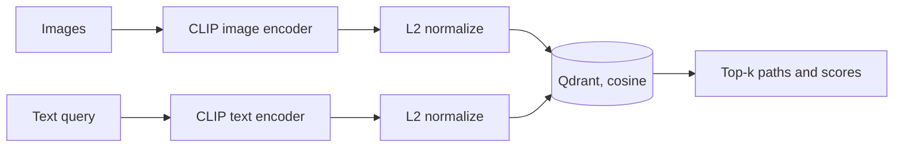

# Smart Asset Search

Text-to-image search over a local image folder. Images and text queries are embedded with CLIP, stored in Qdrant, and ranked by cosine similarity. Interactive CLI prototype.

<!-- TODO: demo GIF -->

 

## Features

- Index a folder of `.jpg`, `.jpeg` and `.png` images (non-recursive).
- Search with free-text queries such as "a red car" and get ranked file paths with scores.
- Collection info (point count, status) from the CLI.
- Runs CLIP on CUDA, MPS or CPU, with automatic CPU fallback.

## How it works



- `src/embeddings/engine.py`: loads `CLIPModel`/`CLIPProcessor` from Hugging Face Transformers (default `openai/clip-vit-base-patch32`) and returns L2-normalized 512-d vectors for images and text.
- `src/vector_db/client.py`: creates the `visual_assets` collection (512-d, cosine) if missing, embeds images and upserts them in batches of 10 with `path`, `filename` and `extension` payload, and runs text-to-image queries.
- `main.py`: interactive menu (index, search, collection info).

Point IDs are the image's position in the directory listing, so re-indexing a different folder into the same collection overwrites points with the same ID.

## Getting started

Prerequisites: Python 3.13, [uv](https://docs.astral.sh/uv/) (or pip), Docker.

```bash
# 1. Start Qdrant (ports 6333 REST, 6334 gRPC; data in ./qdrant_storage)
docker compose up -d

# 2. Install dependencies
uv sync

# 3. Configure (optional; defaults shown in the table below)
export DEVICE=cpu

# 4. Run the CLI
uv run python main.py
```

The menu offers: `1` index a directory (default `data/raw/images`), `2` search (query text, number of results, default 3), `3` collection info, `4` exit. The CLIP weights are downloaded from Hugging Face on first run.

Example session:

```
Select option (1-4): 1
Enter directory path (default: data/raw/images): ./my_photos
Select option (1-4): 2
Enter search query (e.g., 'a red car'): a red car
Number of results (default: 3): 3
```

Each result prints filename, similarity score and path.

### Configuration

Read from environment variables in `src/config.py` (`.env.example` lists them, but the app does not load `.env` by itself; export the variables or use your shell tooling).

| Variable | Default | Meaning |
|---|---|---|
| `QDRANT_HOST` | `localhost` | Qdrant host |
| `QDRANT_PORT` | `6333` | Qdrant REST port |
| `MODEL_NAME` | `openai/clip-vit-base-patch32` | Hugging Face CLIP model |
| `DEVICE` | `cuda` | `cuda`, `mps` or `cpu` |
| `DATA_DIR` | `data` | Data root |

Note: the collection vector size is fixed at 512, so only CLIP models with 512-d embeddings work without code changes.

### Dataset (DVC)

`data/raw/images.dvc` tracks a 128-image dataset (about 6.9 MB). No DVC remote is configured in this repository, so `dvc pull` will not fetch it. Point the CLI at any folder of images instead.

## Tech stack

Python 3.13, PyTorch, Hugging Face Transformers (CLIP), Qdrant (`qdrant-client`), Pillow, DVC, Docker Compose, uv.

## Project structure

```
main.py                  interactive CLI
src/config.py            env-based settings
src/embeddings/engine.py CLIP image/text embeddings
src/vector_db/client.py  Qdrant collection, indexing, search
tests/                   manual scripts that need a running Qdrant (not an automated suite)
notebooks/               embedding experiment
data/raw/images.dvc      DVC pointer to the sample dataset
docker-compose.yml       Qdrant service
```

## Status and limitations

- Working prototype. No retrieval-quality or latency measurements are included.
- No automated tests: `tests/` holds scripts that run against a live Qdrant instance.
- CI runs pylint only (`.github/workflows/pylint.yml`).
- Directory scan is non-recursive; only jpg/jpeg/png.
- Sequential integer point IDs (see above); no deduplication.

## License

MIT, see [LICENSE](LICENSE).
